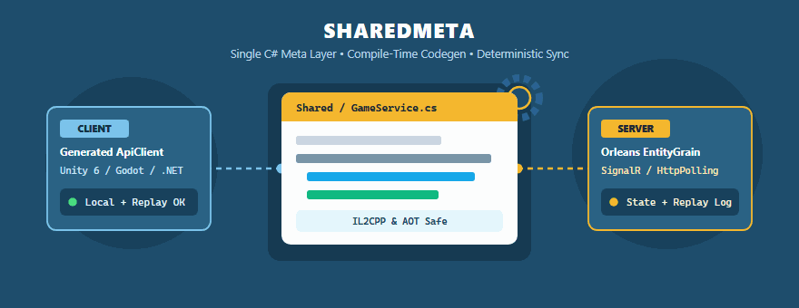
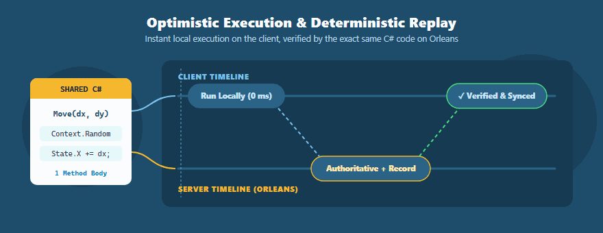
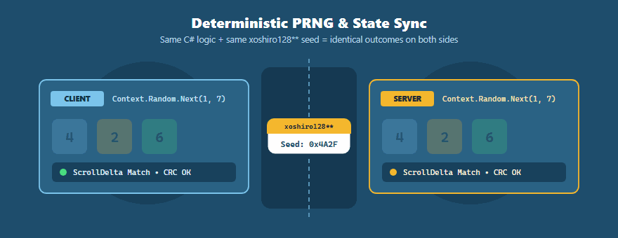
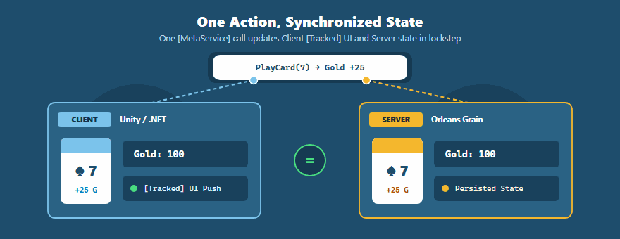

<p align="center">
  
</p>

<h1 align="center">SharedMeta</h1>

<p align="center">
  Shared C# game meta-logic framework for Unity and .NET clients with an Orleans backend and deterministic replay.
</p>

<p align="center">
  <a href="https://github.com/CoreGameIO/SharedMeta/releases"></a>
  <a href="https://www.nuget.org/packages/CoreGame.SharedMeta.Core"></a>
  <a href="https://github.com/CoreGameIO/SharedMeta/blob/main/LICENSE"></a>
  <a href="https://unity.com"></a>
  <a href="https://dotnet.microsoft.com"></a>
  <a href="https://learn.microsoft.com/dotnet/orleans/"></a>
</p>

<p align="center">
  <a href="#how-it-works">How It Works</a> &bull;
  <a href="#minimal-example">Quick Example</a> &bull;
  <a href="#execution-modes">Execution Modes</a> &bull;
  <a href="#installation">Installation</a> &bull;
  <a href="#examples">Examples</a> &bull;
  <a href="docs/GUIDE.md">Documentation</a>
</p>

---

SharedMeta lets you write game meta-logic (profiles, economies, inventories, turn-based matches, clans, lobbies) **once** in C# and run it on both client and server without duplicating rules or shipping full state snapshots on every action.

On the server, each entity runs inside a Microsoft Orleans grain (`EntityGrain<TState>`); the client runs on Unity 6+ or any `.NET 8+` runtime. For both sides, a Roslyn incremental source generator emits typed API clients, server dispatchers and providers, context injection, change trackers, and binary state-patch wrappers at compile time — with zero runtime reflection and full AOT / IL2CPP compatibility.

## How It Works

Instead of treating the client as a dumb view that waits for full-state snapshots, SharedMeta executes the **same service method body** on both sides:

1. **Authoritative server execution & recording** — when a method runs on the server, non-deterministic inputs (`Context.ServerRandom`, `Context.ServerTimeTicks`, cross-entity call results, server-only services) are recorded into a compact replay payload.
2. **Client execution & replay** — depending on the method's `ExecutionMode`, the client either executes immediately before the network round-trip (`Optimistic` / `CrossOptimistic`) and validates against the server response, or waits for the server and replays the recorded payload locally (`Server`).
3. **State diffs when logic diverges** — for server-only resets or mixed-version client rollouts, methods can ship generated field-level binary diffs (`ServerPatch`) or full snapshots (`ServerReplace`) instead of replaying the method body on the client.

<p align="center">
  
</p>

```
┌─────────────────────────────────────────────────────────────────────────┐
│  Meta Layer (SharedMeta.Core, YourGame.Shared)                          │
│  [SharedState], [MetaService], [MetaServiceImpl], [ServiceConfig]       │
│  Compile-time Roslyn generator: clients, dispatchers, patch wrappers    │
└─────────────────────────────────────────────────────────────────────────┘
                                    ↕
┌─────────────────────────────────────────────────────────────────────────┐
│  Middleware Layer (SharedMeta.Client, SharedMeta.Server)                │
│  MetaContext, replay recording/playback, execution modes, desync checks │
└─────────────────────────────────────────────────────────────────────────┘
                                    ↕
┌─────────────────────────────────────────────────────────────────────────┐
│  Serialization Layer (SharedMeta.Serialization.*)                       │
│  IMetaSerializer: MemoryPack (default, VersionTolerant) / MessagePack   │
└─────────────────────────────────────────────────────────────────────────┘
                                    ↕
┌─────────────────────────────────────────────────────────────────────────┐
│  Transport Layer (SharedMeta.Transport.*)                               │
│  IConnection: SignalR (WebSocket), HTTP Long-Polling, BestHTTP, InProc  │
└─────────────────────────────────────────────────────────────────────────┘
                                    ↕
┌─────────────────────────────────────────────────────────────────────────┐
│  Server Backend (SharedMeta.Server.Core, SharedMeta.Orleans)            │
│  EntityGrain<TState>, SessionManagerGrain, persistence, cross-entity    │
└─────────────────────────────────────────────────────────────────────────┘
```

## Minimal Example

### 1. Shared State & Service Contract

```csharp
using MemoryPack;
using MessagePack;
using SharedMeta.Core;

[SharedState]
[MemoryPackable(GenerateType.VersionTolerant), MessagePackObject]
public partial class PlayerState : ISharedState
{
    [Key(0), MemoryPackOrder(0)] public int Gold { get; set; }
    [Key(1), MemoryPackOrder(1)] public List<string> Items { get; set; } = new();
}

[MetaService(StateType = typeof(PlayerState), AccessPolicy = EntityAccessPolicy.UserOwned)]
public interface IPlayerService : IMetaService
{
    [MetaMethod(Mode = ExecutionMode.Optimistic)]
    void AddItem(string itemId);

    [MetaMethod(Mode = ExecutionMode.Server)]
    int OpenChest(int cost);

    [MetaMethod(Mode = ExecutionMode.LocalQuery)]
    bool HasItem(string itemId);
}
```

### 2. Service Implementation

```csharp
[MetaServiceImpl(typeof(IPlayerService), typeof(PlayerState))]
public partial class PlayerService : IPlayerService
{
    public void AddItem(string itemId)
    {
        State.Items.Add(itemId);
    }

    public int OpenChest(int cost)
    {
        if (State.Gold < cost) return 0;
        State.Gold -= cost;

        // Generated on server, recorded into replay payload, replayed identically on client
        int reward = Context.ServerRandom!.Next(50, 200);
        State.Gold += reward;
        return reward;
    }

    public bool HasItem(string itemId) => State.Items.Contains(itemId);
}
```

### 3. Server (`Program.cs`)

```csharp
var builder = WebApplication.CreateBuilder(args);

builder.Host.UseOrleans(silo =>
{
    silo.UseLocalhostClustering();
    silo.AddFileGrainStorage("Default", o => o.RootDirectory = "./data");
    silo.ConfigureServices(services =>
    {
        services.AddSingleton<IMetaSerializer>(new MemoryPackMetaSerializer());
        services.ConfigureMeta(); // Generated from shared assemblies
    });
});

builder.Services.AddSignalR();

var app = builder.Build();
app.MapHub<MetaHub>("/meta");
app.Run();
```

### 4. Client

```csharp
var client = new MetaClient(
    new SignalRConnection("http://localhost:5000/meta"),
    new MemoryPackMetaSerializer()
);
client.Resolver.RegisterAllServices(); // Generated
await client.ConnectAsync();

var api = await client.GetPlayerServiceAsync(); // Generated UserOwned helper
await api.AddItemAsync("sword_01");             // Runs locally immediately, confirmed on server
int reward = await api.OpenChestAsync(25);      // Runs on server, replays recorded RNG on client
bool owned = api.HasItemSync("sword_01");       // Synchronous read over local state, zero RPC
```

## Execution Modes

`[MetaMethod(Mode = ExecutionMode.*)]` controls where a method runs and how state updates reach subscribers:

| Mode | Client Execution | Server Execution | Typical Use |
|---|---|---|---|
| `Optimistic` *(default)* | Executes immediately, validates on server reply | Authoritative execution + broadcast | Responsive player actions (moves, card plays, inventory) |
| `Server` | Waits for reply, then replays recorded inputs | Executes with `ServerRandom` / server-only services | Loot rolls, matchmaking, hidden state |
| `CrossOptimistic` | Executes locally across caller-owned states | Routes cross-entity calls to target grains | Split-profile mutations (`Profile` + `Inventory` + `Quests`) |
| `ServerPatch` | Applies generated binary field diff | Executes via `PatchWrapper` and sends diff | Bandwidth-heavy updates or forced backward compatibility |
| `ServerReplace` | Replaces state snapshot directly | Executes and sends serialized state | Procedural map generation, full state resets |
| `Query` | One-off RPC without subscribing (or local if subscribed) | Read-only execution, no sequence/persistence | Inspecting other players, clan previews (`OpenAccess = true`) |
| `LocalQuery` | Synchronous read over replicated local state, no RPC | Does not run on server | Derived UI getters (`HasItemSync()`, `CardsInHandSync()`) |
| `Signal` | Fire-and-forget (`{Method}Signal()`), no response wait | Read-only execution, errors logged | Telemetry pings, lightweight client notifications |
| `Notification` | Not client-callable | Fire-and-forget cross-entity `[OneWay]` grain call | Async cross-entity updates (`Profile` → `Clan.AddPower`) |

## Key Features

- **Compile-time code generation** — `SharedMeta.Generator` produces service dispatchers, typed `*ApiClient` / `*QueryApi` / `*ServerApi` proxies, DI registration (`ConfigureMeta`, `MetaRefs`), `PatchWrapper` / `PatchApplier`, and reactive state trackers. No reflection or runtime IL emit.
- **Deterministic PRNG & synced clock** — `Context.Random` (xoshiro128** shared stream) and `[NamedRandom("Combat")]` (isolated per-mechanic streams) advance identically on client and server with scroll-delta validation; `Context.ServerRandom` records server rolls for replay; `Context.ServerTimeTicks` provides synchronized UTC ticks.
- **Three-layer desync detection** — checks return values, PRNG scroll deltas, and optional field-level **Patch CRC** (`[MetaServiceImpl(..., DeepDesync = true)]`) with `PatchSchema` JSON diff formatting.
- **Push-based reactive UI** — mark private backing fields with `[Tracked]` to generate public tracking properties and `Tracked{State}.OnChanged` notifications on the client with zero server overhead.
- **Cross-entity calls, triggers & contracts** — call other entities from shared code via declared dependencies, attach automatic post-call `[Trigger(On = ..., Condition = ...)]` hooks, and receive server-pushed callbacks via `[MetaServiceContract]`.
- **Config versioning & schema migration** — bind one or multiple independently-versioned configs via `[ServiceConfig(typeof(TConfig), "Name")]`, declare `[MetaConfigStructureBoundary]` to auto-downgrade legacy clients to `ServerPatch`, and migrate persisted state lazily with `[MetaStateVersion]` + `[MetaInit]` or `IStateLoadedHook`.
- **Pluggable transport & serialization** — SignalR (WebSocket, JSON or native MessagePack protocol), HTTP Long-Polling, BestHTTP / BestHTTP SignalR (Unity incl. WebGL), In-Process (tests), and Mux (multi-player socket multiplexing for load tests). Serializers: MemoryPack and MessagePack.
- **Session resilience & auth** — session resume with missed-packet replay, request idempotency, single-session supersede, optional server RPC reordering, JWT authentication with device/Google/Apple/Steam validators, and `Open` / `Authorized` / `OwnerOnly` / `UserOwned` entity access policies.
- **Observability** — built-in `System.Diagnostics.Metrics.Meter` and `ActivitySource` instrumentation on both server and client for OpenTelemetry / Prometheus.

<p align="center">
  
</p>

## Installation

### Unity (UPM)

Requires **Unity 6000.0+**. Add via **Window > Package Manager > Add package from git URL**:

```text
https://github.com/CoreGameIO/SharedMeta.git#upm
```

Or add to `Packages/manifest.json`:

```json
{
  "dependencies": {
    "com.coregame.sharedmeta": "https://github.com/CoreGameIO/SharedMeta.git#upm"
  }
}
```

The UPM package includes `Orleans.Stubs` (so shared code compiles in Unity without Orleans dependencies) and two Editor windows:
- **Tools > SharedMeta > Project Wizard** — scaffolds the Shared project, ASP.NET Core / Orleans Server project, and Unity client bootstrap scripts, and configures serializer/transport dependencies.
- **Tools > SharedMeta > Server Runner** — starts/stops the local `.csproj` server from Unity, tails colored console logs, and re-attaches across Unity domain reloads.

### .NET (NuGet)

Client packages have no Orleans or ASP.NET Core dependencies (works with Godot `Godot.NET.Sdk`, console apps, tests, etc.). `Core`, `Client`, and `Serialization.MemoryPack` target `netstandard2.1` / `net8.0` / `net10.0` / `net11.0`; transports and `Serialization.MessagePack` target `net8.0` / `net10.0` / `net11.0`:

```bash
# Shared & Client
dotnet add package CoreGame.SharedMeta.Core
dotnet add package CoreGame.SharedMeta.Client
dotnet add package CoreGame.SharedMeta.Serialization.MemoryPack
dotnet add package CoreGame.SharedMeta.Transport.SignalR.Client
dotnet add package CoreGame.SharedMeta.Generator
```

Optional client packages:
- `CoreGame.SharedMeta.Serialization.MessagePack`
- `CoreGame.SharedMeta.Transport.SignalR.MessagePack`
- `CoreGame.SharedMeta.Transport.HttpPolling.Client`

Server packages (`net8.0` / `net10.0` / `net11.0`):

```bash
dotnet add package CoreGame.SharedMeta.Server
dotnet add package CoreGame.SharedMeta.Orleans
dotnet add package CoreGame.SharedMeta.Transport.SignalR
dotnet add package CoreGame.SharedMeta.Serialization.MemoryPack
# Optional: CoreGame.SharedMeta.Transport.HttpPolling, CoreGame.SharedMeta.Auth(.Google|.Apple|.Steam)
```

## Examples

<p align="center">
  
</p>

Example projects multi-target `net8.0;net10.0;net11.0` (specify `-f net10.0` or your installed SDK when using `dotnet run`):

| Example | Path | What It Demonstrates |
|---|---|---|
| **CardGame "The Fool"** | [`examples/CardGame_TheFool`](examples/CardGame_TheFool) | Multiplayer turn-based card game with matchmaking lobby, `Optimistic` card plays, `Server` deck shuffle, `[Trigger]` auto-end turn, `[Transformer]` argument boxing, and a Spectre.Console client. |
| **Expedition** | [`examples/Expedition`](examples/Expedition) & [`examples/Unity/Expedition`](examples/Unity/Expedition) | Procedural dungeon exploration with `CrossOptimistic` cross-entity economy (`Profile` + `Expedition`), `[MetaInit]`, `[ServiceConfig]`, `[Tracked]` reactive UI, `Query` calls, `DeepDesync`, and a Unity 6 client. |
| **ClanWars** | [`examples/ClanWars`](examples/ClanWars) | Mobile-RPG profile and clan backend showcasing `EntityScope`, `Notification` cross-entity calls, `[MetaConfigStructureBoundary]` mixed-version clients (`V1`/`V2`), OpenTelemetry observability, and a multi-process Mux stress runner. |

Quick run for **CardGame "The Fool"**:

```bash
# Terminal 1 — server
dotnet run --project examples/CardGame_TheFool/CardGame.Server -f net10.0

# Terminal 2 & 3 — two clients
dotnet run --project examples/CardGame_TheFool/CardGame.Client -f net10.0
dotnet run --project examples/CardGame_TheFool/CardGame.Client -f net10.0
```

## Tooling

### JetBrains Rider Plugin

[`SharedLibs/RiderPlugin`](https://github.com/CoreGameIO/SharedLibs/tree/main/RiderPlugin) connects `[MetaService]` interface methods to all code generated by `SharedMeta.Generator` via `[GeneratedFromMetaMethod]`:

- **Find Usages** on a `[MetaMethod]` includes call sites on generated `*ApiClient`, `*QueryApi`, `*ServerApi`, `*EntityCaller`, `*EntityRecorder`, and `*EntityReplayer` types.
- **Ctrl+Click / Go to Declaration** on a generated method offers the originating `[MetaMethod]` declaration as a navigation target.

Download the pre-built archive from [`SharedLibs/RiderPlugin/dist/`](https://github.com/CoreGameIO/SharedLibs/tree/main/RiderPlugin/dist) and install via **Settings > Plugins > ⚙ > Install Plugin from Disk…**.

## Repository Layout

| Path | Contents |
|---|---|
| `com.coregame.sharedmeta/` | Unity UPM package (`Runtime/` core/client/transports/serializers/stubs + `Editor/` Project Wizard & Server Runner) |
| `src/SharedMeta.Core/` | Attributes, `MetaContext`, deterministic PRNG, patch runtime, transport/serialization contracts |
| `src/SharedMeta.Client/` | `MetaClient`, `ClientDispatcher`, `MetaServiceResolver`, config caching, token management |
| `src/SharedMeta.Generator/` | Roslyn incremental source generator |
| `src/SharedMeta.Server/` | Server-side `MetaContext` and cross-entity recording |
| `src/SharedMeta.Server.Core/` | `IMetaProvider<TState>`, `MetaProviderBase`, `FileGrainStorage`, config providers, session management |
| `src/SharedMeta.Orleans/` | `EntityGrain<TState>`, `SessionManagerGrain`, `LobbyGrain`, Orleans clustering/DI integration |
| `src/SharedMeta.Transport.*` | `SignalR`, `SignalR.Client`, `SignalR.MessagePack`, `HttpPolling`, `HttpPolling.Client` |
| `src/SharedMeta.Serialization.*` | `MemoryPack` and `MessagePack` `IMetaSerializer` implementations |
| `src/SharedMeta.Auth*` | JWT auth grains/endpoints + `Google`, `Apple`, and `Steam` external validators |
| `src/SharedMeta.Debug/` | `InProcess` test transport and `Mux` load-testing transport |
| `src/Orleans.Stubs/` | No-op Orleans/serialization attributes for client-only builds |
| `examples/` | `CardGame_TheFool`, `Expedition`, `Unity/Expedition`, `ClanWars` |
| `tests/` | Unit, integration, serializer, and patch fuzz tests |
| `docs/` | [Framework Guide](docs/GUIDE.md) and [Architecture Decisions](docs/ARCHITECTURE.md) |

## Documentation & Changelog

- [Framework Guide (`docs/GUIDE.md`)](docs/GUIDE.md) — complete reference covering all execution modes, configs, triggers, transformers, reactive tracking, persistence, auth, telemetry, and testing.
- [Architecture (`docs/ARCHITECTURE.md`)](docs/ARCHITECTURE.md) — layer design and core technical decisions.
- [Changelog (`CHANGELOG.md`)](CHANGELOG.md) — release history and migration notes.

## License

[MIT](LICENSE)
