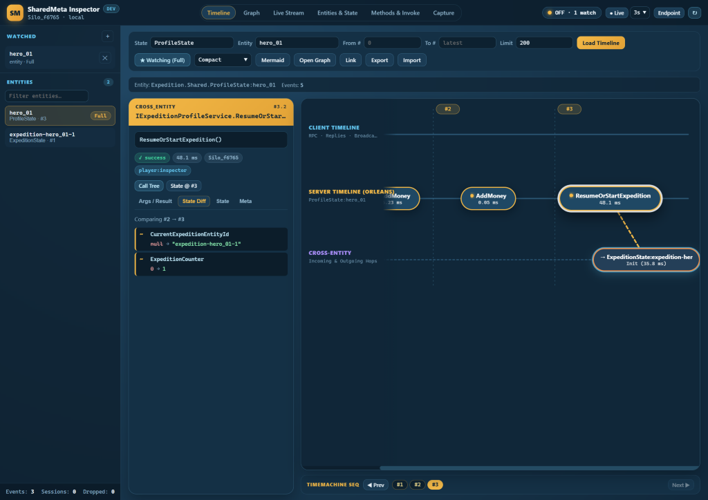
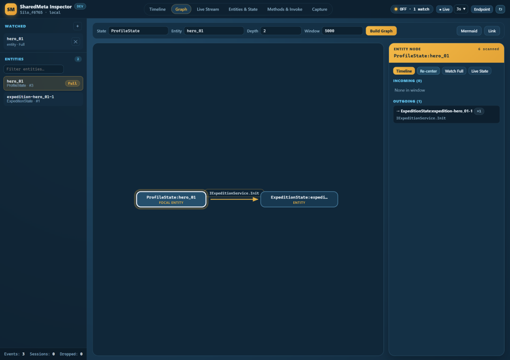
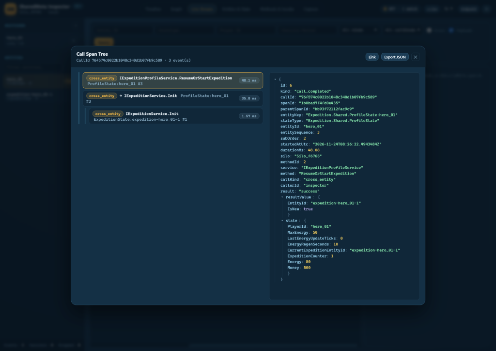
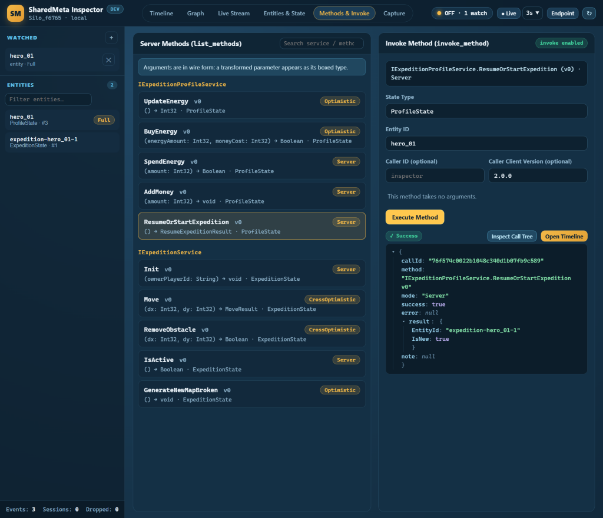

# SharedMeta Inspector, MCP & TimeMachine

**SharedMeta Inspector** is a zero-overhead runtime debugger, **TimeMachine** timeline & state-diff viewer, and **Model Context Protocol (MCP)** server for running SharedMeta / Orleans game servers.

> **Preview (0.49.0).** The Inspector packages are new: tool names, options and the event format may still change in minor versions. The framework hooks they rely on (call tap, method descriptors) are stable and cost nothing when the Inspector is not referenced.

It attaches as an optional server module without modifying a single line of your shared game code:
- **Zero cost when idle (`Level = Off`)** — compile-time code generation (`[MetaCallTapProvider]`) emits fast-path call taps and wire-level method descriptors only when `SharedMeta.Inspector` is referenced. When capture is off, no arguments, results, or state snapshots are copied or decoded.
- **TimeMachine** — pick any entity and inspect every RPC, `[MetaInit]` migration, `[Trigger]`, cross-entity hop, broadcast, and client reply in exact `(EntitySequence, SubOrder)` order, with per-sequence state snapshots and automatic field diffs.
- **Built-in Web Viewer** — served directly from ASP.NET Core at `/inspector/` (zero Node.js / bundler dependencies), communicating over the same `/mcp` Streamable HTTP endpoint.
- **AI Agent Access (MCP)** — 17 stateless Streamable HTTP MCP tools let Claude Code, Cursor, Antigravity, or custom scripts inspect timelines, diffs, live entity state, and (optionally) invoke methods on a running server.
- **Multi-Silo & History (NATS JetStream)** — optionally stream events across all silos, share watches and method schemas through NATS KV, and query durable per-entity history via an embedded silo inspector or the standalone `sharedmeta-inspector` CLI tool.

<p align="center">
  
</p>

---

## Table of Contents

- [Quick Start (Single Silo)](#quick-start-single-silo)
- [Web Viewer Tour](#web-viewer-tour)
  - [TimeMachine Timeline & State Diff](#timemachine-timeline--state-diff)
  - [Entity Dependency Graph](#entity-dependency-graph)
  - [Live Event Stream & Call Span Tree](#live-event-stream--call-span-tree)
  - [Methods Schema & Interactive Invoke](#methods-schema--interactive-invoke)
  - [Capture Rules, Watches & Auto-Revert TTL](#capture-rules-watches--auto-revert-ttl)
  - [Deep Links & Offline JSON Snapshots](#deep-links--offline-json-snapshots)
- [Using with AI Agents (MCP)](#using-with-ai-agents-mcp)
  - [Connecting MCP Clients](#connecting-mcp-clients)
  - [Example Debugging Prompts](#example-debugging-prompts)
  - [MCP Tool Reference (17 Tools)](#mcp-tool-reference-17-tools)
  - [Calling MCP Directly via HTTP / curl](#calling-mcp-directly-via-http--curl)
- [Multi-Silo & Standalone Inspector (NATS JetStream)](#multi-silo--standalone-inspector-nats-jetstream)
- [Deploying on a Shared Dev / Staging Server](#deploying-on-a-shared-dev--staging-server)
- [Packages Overview](#packages-overview)

---

## Quick Start (Single Silo)

### 1. Install Packages

Add the Inspector and MCP packages to your **Server** project (your Shared project stays untouched; referencing `SharedMeta.Inspector` automatically activates call-tap & method-descriptor codegen on the server):

```bash
dotnet add package CoreGame.SharedMeta.Inspector
dotnet add package CoreGame.SharedMeta.Inspector.Mcp
```

### 2. Wire Up `Program.cs`

```csharp
using SharedMeta.Inspector;
using SharedMeta.Inspector.Mcp;

// Register the Inspector runtime, call tap, grain call filter, and MCP tools.
// Capture starts Off by default (zero overhead until a watch or capture rule is enabled).
builder.Services.AddSharedMetaInspector(o =>
{
    // Optional: allow invoking methods on a local / dev server (disabled by default)
    o.AllowInvoke = builder.Environment.IsDevelopment();
    o.InvokeMethods.Add("*");
});
builder.Services.AddSharedMetaInspectorMcp();

var app = builder.Build();

// Expose the Streamable HTTP MCP endpoint and embedded Web Viewer
app.MapSharedMetaInspectorMcp("/mcp");
app.MapSharedMetaInspectorUi("/inspector", "/mcp");
```

### 3. Try It on the Included Examples

Both [`Expedition.Server`](../examples/Expedition/Expedition.Server/Program.cs) and [`CardGame.Server`](../examples/CardGame_TheFool/CardGame.Server/Program.cs) come pre-wired with MCP and the Web Viewer:

```bash
# Start Expedition.Server (default port 5100, AllowInvoke enabled on loopback)
dotnet run --project examples/Expedition/Expedition.Server -f net10.0
```

Open **`http://localhost:5100/inspector/`** in your browser, or connect an MCP client to **`http://localhost:5100/mcp`**.

> **Tip:** Capture is `Off` by default so idle servers pay zero overhead. Start by adding an **Entity Watch** (level `Full`) in the **Capture** tab or via `watch_entity` before reproducing a scenario.

---

## Web Viewer Tour

The embedded SPA talks directly to `/mcp` using stateless MCP Streamable HTTP JSON-RPC. If the server requires an `ApiKey`, the viewer prompts for `X-Inspector-Key` automatically (stored in `sessionStorage`), and you can also switch endpoints in the top bar.

### TimeMachine Timeline & State Diff

The **Timeline** tab (`entity_timeline` + `entity_state_at`) renders an interactive swimlane view of an entity's execution history:

- **CLIENT TIMELINE** *(cyan / emerald)* — client RPC origins, `✓ Verified & Synced` replies, `📡 Broadcast ×N` fan-outs, and `subscribed` / `reclaimed` / `unsubscribed` events.
- **SERVER TIMELINE (ORLEANS)** *(amber / violet)* — authoritative method dispatches, `[MetaInit]` schema migrations, chained `[Trigger]` / `nested` dispatches, and gold snapshot dots (`●`) whenever `Full` state was recorded.
- **CROSS-ENTITY** *(orange)* — incoming cross-entity callers and outgoing `call_sent` hops with one-click jump to the target entity's timeline.
- **Left Inspector Card** — displays the selected operation's signature, decoded wire arguments, return value/error, metadata, full state snapshot, and an automatic **State Diff** comparing `#seq - 1 → #seq`.
- **Sequence Scrubber** — step backward/forward (`◀ Prev` / `Next ▶`) across entity operations to watch state mutations evolve step by step, or export the server's **Mermaid** `sequenceDiagram`.

<p align="center">
  
</p>

### Entity Dependency Graph

The **Graph** tab (`entity_graph`) maps all entities and players connected to a focal entity via RPCs, cross-entity calls, and broadcasts within `depth` hops (1–6):

- Drag nodes freely to inspect dense subgraphs.
- Click any entity or player node to view its incoming/outgoing methods and call counts (`×N`), re-center the graph, jump to its Timeline, read its Live State, or add a Watch.
- Export as a **Mermaid** `flowchart LR` diagram.

<p align="center">
  
</p>

### Live Event Stream & Call Span Tree

The **Live Stream** tab (`recent_calls`) lets you filter captured events by `entityId`, `stateType`, `playerId`, `method`, `kind`, `callKind`, and `errorsOnly`, with optional auto-polling (`● Live`).

Clicking any 32-hex `CallId` opens the **Call Span Tree** modal (`get_call`), reconstructing the full causal hierarchy across entities, triggers, outgoing `call_sent` hops, broadcasts, and client replies with decoded JSON payloads:

<p align="center">
  
</p>

### Methods Schema & Interactive Invoke

The **Methods & Invoke** tab (`list_methods` + `invoke_method`) lists every server-dispatched `[MetaMethod]` grouped by service, with version, execution mode, declared vs. wire parameter types (marking `[Transformer]`-boxed parameters), and result type.

When `InspectorOptions.AllowInvoke` is enabled and the method matches `InvokeMethods`:
- Select a method to generate a typed argument form (or toggle to **Raw JSON** mode).
- Mutating calls open a **Confirmation Modal** displaying the environment, target entity, method, and wire arguments before executing (read-only `Query` calls run directly; you can opt to skip confirmation for the current browser session).
- After execution, jump straight into **Inspect Call Tree** or **Open Timeline** for the returned `callId`.

<p align="center">
  
</p>

### Capture Rules, Watches & Auto-Revert TTL

The **Capture** tab (`inspector_status`, `get_capture_config`, `set_capture_config`, `watch_entity`, `watch_player`) controls what gets captured at runtime with zero restarts:

- **Capture Levels:** `Off` → `Ids` (metadata only) → `Args` (+ wire args) → `ArgsResult` (+ return value) → `Full` (+ entity state snapshot after each call, required for `entity_state_at` and State Diff).
- **Focused Watches (recommended):** watch specific `entityId`s or `playerId`s at `Full` without affecting the rest of the server. Watches are never sampled.
- **Per-Method Overrides:** target `"IService.Method"`, `"IService.*"`, or `"*"` with optional `sampleRate` (`0..1`).
- **Global Auto-Revert TTL:** when raising the global capture level above `Off` on a shared server, a warning banner appears and an automatic TTL timer (default `15 min`, configurable or capped server-side via `InspectorOptions.MaxGlobalCaptureDuration`) automatically reverts the global level back to `Off` while keeping focused watches intact.

### Deep Links & Offline JSON Snapshots

- **Deep Links (`Link` button):** Timeline, Graph, and Call Span Tree state is synced to the URL hash (`#view=timeline&stateType=ProfileState&entityId=hero_01&seq=3` or `#callId=...`). Copy and paste the URL in chat or issue trackers to open the exact view on another machine.
- **Export / Offline Import (`Export` & `Import` buttons):** Download any entity timeline or Call Span Tree as a `.json` snapshot to attach to bug reports, then load it back via **Import** completely offline (with full interactive swimlanes, State Diff, and Call Tree).

---

## Using with AI Agents (MCP)

### Connecting MCP Clients

The MCP endpoint uses **Streamable HTTP (stateless)** at `/mcp`.

**Claude Code:**
```bash
# Local server (loopback, no API key)
claude mcp add --transport http sharedmeta http://localhost:5100/mcp

# Remote dev server with API key (always use HTTPS outside localhost)
claude mcp add --transport http sharedmeta-dev https://dev.mygame.internal/mcp \
  --header "X-Inspector-Key: YOUR_INSPECTOR_KEY"
```

**Generic MCP JSON config (Cursor / Windsurf / Antigravity / etc.):**
```json
{
  "mcpServers": {
    "sharedmeta": {
      "url": "http://localhost:5100/mcp",
      "headers": {
        "X-Inspector-Key": "YOUR_INSPECTOR_KEY"
      }
    }
  }
}
```

### Example Debugging Prompts

Once connected, your AI agent can debug live game state and causality directly:

- *"Check `inspector_status` and watch entity `hero_01` at level `Full`, then tell me when you're ready."*
- *"Show me the timeline of `ProfileState` `hero_01` and explain why `Money` dropped between seq 4 and seq 6."*
- *"Inspect call `76f574c0022b1048c340d1b07fb9c589` with `get_call` and trace what it triggered on `ExpeditionState`."*
- *"Build the `entity_graph` around `ProfileState` `hero_01` and check which entities received cross-entity calls."*
- *"Read live `Inventory.Items[0]` on `ProfileState` `hero_01`."*
- *"Invoke `IExpeditionProfileService.AddMoney` with `amount = 500` on `hero_01` (clientVersion `2.0.0`) and verify the resulting state."*

### MCP Tool Reference (17 Tools)

| Category | Tool | Purpose |
|---|---|---|
| **Overview** | `inspector_status` | Silo name, environment, capture availability, global level & TTL, watch counts, stored/dropped counts, sessions, distribution mode. |
| | `list_methods` | All server-dispatched methods (service, alias, version, C# name, mode, stateType, declared/wire params, result) and state types. |
| **Capture** | `get_capture_config` | Current global level, expiration deadline, per-method rules, watches, sample rate, broadcast folding. |
| | `set_capture_config` | Update global `level`, `methodLevels`, `sampleRate`, `broadcastPerSubscriber`, and optional `globalTtlMinutes`. |
| | `watch_entity` / `unwatch_entity` | Capture all activity of one entity (default `Full`) without sampling; stop watching. |
| | `watch_player` / `unwatch_player` | Capture all calls made by and broadcasts sent to one player; stop watching. |
| **Events** | `recent_calls` | Filterable newest-first event log (`entityId`, `stateType`, `playerId`, `method`, `kind`, `callKind`, `errorsOnly`, `sinceId`, `limit`, `includePayloads`). |
| | `get_call` | Full span tree of a single `callId` (dispatches, triggers, nested, cross-entity `call_sent`, broadcasts, client reply). |
| **TimeMachine** | `entity_timeline` | Entity events in `(EntitySequence, SubOrder)` order (including broker history when attached) + Mermaid `sequenceDiagram`. |
| | `entity_graph` | Connected entities and players within `depth` hops from the newest `window` events + Mermaid `flowchart LR`. |
| | `entity_state_at` | Reconstruct entity state after sequence `seq` (from `Full`-captured events), reporting `actualSeq` and `isExact`. |
| **Live** | `list_entities` | Recently seen entities (most recent first) with their `lastSequence` and `lastSeenUtc`. |
| | `list_sessions` | Currently open client sessions on this host. |
| | `get_entity_state` | Read current live grain state, optionally drilled to a dot/index `path` (e.g. `Inventory.Items[0]`); `activate=true` allows reading unseen grains. |
| | `invoke_method` | Invoke a server meta method as server code (requires `AllowInvoke = true` and `InvokeMethods` allow-list). Routes `Query`, `Signal`, `Notification`, and standard calls automatically. |

### Calling MCP Directly via HTTP / `curl`

Because the endpoint runs stateless Streamable HTTP, scripts can invoke tools with a single POST request:

```bash
curl -s http://localhost:5100/mcp \
  -H "Content-Type: application/json" \
  -H "Accept: application/json, text/event-stream" \
  -d '{"jsonrpc":"2.0","id":1,"method":"tools/call","params":{"name":"inspector_status","arguments":{}}}'
```

---

## Multi-Silo & Standalone Inspector (NATS JetStream)

When running multiple Orleans silos, attach **`CoreGame.SharedMeta.Inspector.Nats`** so every silo publishes events into a shared NATS JetStream stream and shares capture rules, watches, TTLs, and method schemas via a NATS KV bucket.

### 1. Attach NATS to Every Silo

```bash
dotnet add package CoreGame.SharedMeta.Inspector.Nats
```

```csharp
builder.Services.AddSharedMetaInspector();
builder.Services.AddSharedMetaInspectorMcp();
builder.Services.AddSharedMetaInspectorNats(o =>
{
    o.Url = builder.Configuration["Inspector:NatsUrl"] ?? "nats://127.0.0.1:4222";
    o.StreamName = "SHAREDMETA_INSPECTOR";
    o.ControlBucket = "sharedmeta-inspector";
});
```

- Every silo publishes its events and its `list_methods` schema to NATS.
- Changing a watch or capture rule on any silo (or on the standalone inspector) propagates immediately across the entire cluster.
- `entity_timeline` and `entity_state_at` automatically merge the in-memory store with durable JetStream history.
- If NATS is temporarily unreachable at startup, the bridge retries in the background and never blocks the game server.

### 2. Optional Standalone Inspector Tool (`sharedmeta-inspector`)

If you prefer a dedicated read-only Web Viewer + MCP service outside the game silos:

```bash
dotnet tool install -g CoreGame.SharedMeta.Inspector.Service

sharedmeta-inspector \
  --nats nats://127.0.0.1:4222 \
  --port 5300 \
  --env STAGING \
  --max-global-minutes 15 \
  --allow-remote true \
  --api-key "$INSPECTOR_API_KEY"
```

Open **`http://localhost:5300/`** (redirects to `/inspector/`) or connect MCP to **`http://localhost:5300/mcp`**.

All CLI flags can also be configured via environment variables prefixed with `SHAREDMETA_INSPECTOR_` (using `_` in place of `-`):

| Option | Env Variable | Default | Description |
|---|---|---|---|
| `--nats` | `SHAREDMETA_INSPECTOR_NATS` | `nats://127.0.0.1:4222` | NATS server URL(s) |
| `--port` | `SHAREDMETA_INSPECTOR_PORT` | `5300` | HTTP port for `/mcp` and `/inspector/` |
| `--stream` | `SHAREDMETA_INSPECTOR_STREAM` | `SHAREDMETA_INSPECTOR` | JetStream stream name |
| `--prefix` | `SHAREDMETA_INSPECTOR_PREFIX` | `sharedmeta.inspector` | Event subject prefix |
| `--bucket` | `SHAREDMETA_INSPECTOR_BUCKET` | `sharedmeta-inspector` | NATS KV bucket for capture rules & method schema |
| `--warm-minutes` | `SHAREDMETA_INSPECTOR_WARM_MINUTES` | `60` | Minutes of recent events preloaded on startup |
| `--max-events` | `SHAREDMETA_INSPECTOR_MAX_EVENTS` | `200000` | In-memory event ring capacity |
| `--manage-stream` | `SHAREDMETA_INSPECTOR_MANAGE_STREAM` | `false` | Create stream/bucket if missing (silos own them by default) |
| `--allow-remote` | `SHAREDMETA_INSPECTOR_ALLOW_REMOTE` | `false` | Listen on `0.0.0.0` instead of `localhost` (always pair with `--api-key` + HTTPS) |
| `--api-key` | `SHAREDMETA_INSPECTOR_API_KEY` | *(none)* | Required `X-Inspector-Key` / `Bearer` token |
| `--env` | `SHAREDMETA_INSPECTOR_ENV` | *(host env)* | Environment badge shown in the Web UI (`DEV`, `STAGING`, `PROD`, etc.) |
| `--path-base` | `SHAREDMETA_INSPECTOR_PATH_BASE` | *(none)* | Reverse-proxy subpath prefix (e.g. `/staging/inspector`) |
| `--max-global-minutes` | `SHAREDMETA_INSPECTOR_MAX_GLOBAL_MINUTES` | `0` *(no cap)* | Server-enforced upper bound on global capture TTL |

> **Note:** Standalone inspectors do not host Orleans grains, so `get_entity_state` and `invoke_method` remain available only on silo-hosted inspectors. `list_methods`, timelines, graphs, state history, and watches work identically on both.

---

## Deploying on a Shared Dev / Staging Server

For a team dev server, hosting the Inspector directly inside the dev silo (behind HTTPS + VPN / SSO / reverse proxy) gives developers and QA instant browser access plus live state inspection and method invocation:

```csharp
builder.Services.AddSharedMetaInspector(o =>
{
    o.LocalhostOnly = false;
    o.ApiKey = builder.Configuration["Inspector:ApiKey"];
    o.EnvironmentName = builder.Environment.EnvironmentName; // e.g. "Development" or "Staging"
    o.MaxGlobalCaptureDuration = TimeSpan.FromMinutes(30);   // Prevents forgotten global Full capture
    o.AllowInvoke = builder.Environment.IsDevelopment();
    o.InvokeMethods.Add("*");                                // Or restrict to ["IAdminService.*", "IProfileService.AddMoney"]
    o.RedactMembers.AddRange(["*email*", "*receipt*"]);      // "*password*", "*token*", "*secret*" are redacted by default
});
builder.Services.AddSharedMetaInspectorMcp();

var app = builder.Build();

// Optional: when hosted behind a reverse-proxy subpath (e.g. https://dev.game.internal/game-api/inspector/)
// app.UsePathBase("/game-api");

// Both MapSharedMetaInspectorMcp and MapSharedMetaInspectorUi (RouteGroupBuilder)
// support standard ASP.NET Core endpoint conventions such as RequireAuthorization:
app.MapSharedMetaInspectorMcp("/mcp").RequireAuthorization("DevAdmin");
app.MapSharedMetaInspectorUi("/inspector", "/mcp").RequireAuthorization("DevAdmin");
```

### Security Checklist

- **Always terminate TLS (HTTPS)** in front of the Inspector whenever `LocalhostOnly = false`, so `X-Inspector-Key` / Bearer tokens and decoded payloads are never sent in plaintext.
- **Lock down `AllowInvoke`** — keep `AllowInvoke = false` on staging/production (or restrict `InvokeMethods` to safe diagnostic methods).
- **Use `MaxGlobalCaptureDuration`** on shared servers so nobody accidentally leaves global `Level = Full` enabled overnight.
- **Check `RedactMembers`** — matching property names and dictionary keys are replaced with `"***"` before events leave the silo encoder.
- **Reverse-proxy subpaths** — `MapSharedMetaInspectorUi` honors `HttpRequest.PathBase` for both `/inspector` → `{PathBase}/inspector/` redirects and the injected `{PathBase}/mcp` endpoint URL.

---

## Packages Overview

| Package | Purpose |
|---|---|
| `CoreGame.SharedMeta.Inspector` | Silo runtime, `[MetaCallTapProvider]` marker, outgoing grain call filter, transport observer, ring buffer store, `InspectorService`, JSON redaction, global capture TTL. |
| `CoreGame.SharedMeta.Inspector.Mcp` | Streamable HTTP MCP endpoint (`MapSharedMetaInspectorMcp`, 17 tools) and embedded TimeMachine Web Viewer (`MapSharedMetaInspectorUi`). |
| `CoreGame.SharedMeta.Inspector.Nats` | NATS JetStream event sink/source/history and NATS KV shared capture settings + method schema sync. |
| `CoreGame.SharedMeta.Inspector.Service` | Standalone `sharedmeta-inspector` dotnet global tool serving the Web Viewer and MCP over a NATS JetStream cluster. |
